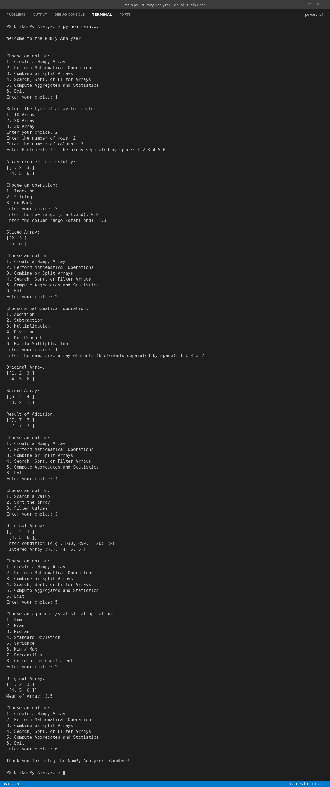

# 📊 NumPy Analyzer

> A menu-driven console application for array creation, manipulation, and statistical analysis, built with **NumPy** and **Object-Oriented Programming** in Python.

---

## 📝 Project Description

**NumPy Analyzer** is a command-line data analysis tool that lets users create and work with NumPy arrays interactively. The application is built around a single `DataAnalytics` class that demonstrates core OOP principles such as encapsulation, private methods, class methods, and static methods.

From a simple menu, users can create 1D, 2D, or 3D arrays, slice and index them, perform mathematical operations, combine or split arrays, search, sort, and filter values, and compute common statistics.

---

## ✨ Features

### 🧱 Array Management
- 🔢 Create **1D, 2D, and 3D** arrays from user input
- 🎯 **Indexing** to access individual elements
- ✂️ **Slicing** with a simple `start:end` range format

### ➕ Mathematical Operations
- ➕ Addition, ➖ Subtraction, ✖️ Multiplication, ➗ Division
- 🔗 Dot Product
- 🧮 Matrix Multiplication

### 🔀 Combine & Split
- 🧩 Combine arrays using **vertical stacking**
- 🪓 Split an array into any number of parts

### 🔍 Search, Sort & Filter
- 🔎 **Search** for a value and get its indices
- 📶 **Sort** arrays (row-wise for 2D arrays)
- 🧹 **Filter** values with conditions like `>30`, `<50`, `==20`

### 📈 Aggregates & Statistics
- Sum, Mean, Median
- Standard Deviation and Variance
- Minimum and Maximum
- Percentiles
- Correlation Coefficient

### 🧠 OOP & Code Quality
- 🔒 **Encapsulation** with private attributes (`__array`, `__history`)
- 🛠️ **Private methods** for validation and range parsing
- 🏭 **Class method** `from_list()` to create an object from a Python list
- ⚙️ **Static methods** such as `is_valid_numeric()` and `show_info()`
- 🛡️ Error handling with `try/except` for invalid input
- 🖥️ Clean, loop-based **menu-driven interface**

---

## 🛠️ Technologies Used

| Technology | Purpose |
|------------|---------|
| 🐍 **Python 3** | Core programming language |
| 🔢 **NumPy** | Array creation and numerical computation |
| 🧬 **OOP Concepts** | Classes, encapsulation, class & static methods |
| 💻 **Command Line (CLI)** | Menu-driven user interface |
| 🆚 **VS Code** | Code editor used to write and run the project |
| 🌐 **Git & GitHub** | Version control and project hosting |

---

## ⚙️ How to Run / Installation

### 📋 Prerequisites
- 🐍 **Python 3.8 or higher** installed on your system
- 📦 **pip** (comes with Python)
- 🆚 **VS Code** (or any code editor / terminal)

### 🚀 Step-by-Step Guide

1. 🔍 **Check that Python is installed**
   ```bash
   python --version
   ```
   If this does not work, try `python3 --version`.

2. 📂 **Download the project**
   - Download or copy `main.py` into a folder on your computer
   - Open that folder in **VS Code** (`File → Open Folder`)

3. 💻 **Open the terminal**
   - In VS Code, press `` Ctrl + ` `` or go to `Terminal → New Terminal`
   - Make sure the terminal is inside the project folder

4. 📦 **Install NumPy**
   ```bash
   pip install numpy
   ```

5. ✅ **Verify the installation**
   ```bash
   python -c "import numpy; print(numpy.__version__)"
   ```
   If a version number is printed, NumPy is installed correctly.

6. ▶️ **Run the application**
   ```bash
   python main.py
   ```

---

## 📁 Project Structure

```
├── main.py        # Main program (DataAnalytics class + menu)
├── output.png     # Screenshot of the program output
└── README.md      # Project documentation
```

---

## 🖥️ Output



## 👩‍💻 Author

**Kajal Mahato**